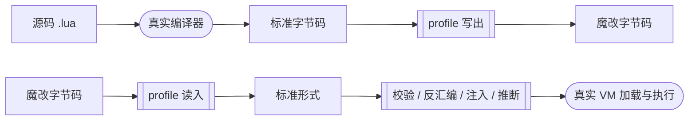

# luarecomp 设计说明

本工具不写编译器，也不写虚拟机。编译和执行都交给真实的 Lua / LuaJIT，它只负责在「标准字节码」和「魔改字节码」之间做格式转换，再在标准格式上做分析和修改。

支持 Lua 5.1 – 5.4、LuaJIT 2.0 / 2.1。Python 3.10+，依赖 [lupa](https://github.com/scoder/lupa)。用法见 [README](../README.md)。

## 数据怎么流动



圆角框交给真实 Lua / LuaJIT，双线框由本工具负责。

读入时就把游戏的 opcode 编号、指令位域、常量标记全部还原成标准值；写出时再按 profile 改回去。所有分析功能都只面对标准形式，所以换一款游戏只需要换 profile，代码不用动。

## 五个设计选择

| 选择 | 说明 |
|---|---|
| **内部一律用标准形式** | 校验、反汇编、注入、推断各自只需针对标准指令集写一次。魔改只存在于读写那一层。 |
| **格式差异用数据描述** | 游戏改了什么，就在 JSON profile 里写什么：文件头字段、函数结构的顺序、编码方式、opcode 映射、指令位域。描述不了的才用插件；插件是可执行代码，必须加 `--allow-plugin` 才会加载。 |
| **一张操作数角色表** | `isa.py` 记录每个 opcode 的每个操作数是寄存器、常量、upvalue 还是跳转目标。校验器、反汇编器和 opcode 推断都由它驱动。这张表在真实编译器的全部产物上误报为零，LuaJIT 部分还和 VM 内部的模式位逐项比对过。 |
| **逐字节往返** | 读进来再写回去，必须和原文件一个字节不差。不一致就说明 profile 没把格式描述完整，`check` 会指出第一个不一致的字节属于哪个字段。 |
| **宁可说不知道** | `inspect` 有歧义时列出所有可能和缺什么样本；`infer-ops` 区分不了的 opcode 列为歧义组；`check` 分三层报告卡在哪里。工具不替你猜。 |

## profile 能改到多细：一条指令

Lua 5.3 的每条指令是一个 32 位字。下面是标准布局，以及仓库里虚构示例 [`profiles/example_deep.json`](../profiles/example_deep.json) 的布局：

```
位       31        23 22        14 13      6 5    0
标准     [    B     ] [    C     ] [   A   ] [ op ]

位       31    26 25      18 17         9 8          0
魔改     [  op  ] [   A    ] [    C     ] [    B     ]
```

两者之间的换算全部由 profile 里的两个字段完成：

```jsonc
"instruction": {"op": [26, 6], "A": [18, 8], "C": [9, 9], "B": [0, 9], "Bx": [0, 18], "Ax": [0, 26]},
"opcodes": {"type": "affine", "mul": 5, "add": 11, "mod": 47}   // 游戏编号 = (标准编号 × 5 + 11) mod 47
```

## 模块

| 层 | 模块 | 职责 |
|---|---|---|
| 指令集 | `isa.py` | 6 种 VM 的 opcode、指令格式、操作数角色、位域，纯数据 |
| 格式描述 | `profile.py` | 读取并校验 profile，报错时给出字段路径和拼写建议 |
| 读写 | `puc.py`、`luajit.py` | 按 profile 读写字节，记录每个字段的偏移，供诊断定位 |
| 真实 VM | `runtime.py` | 通过 lupa 调用各版本的编译、加载、执行 |
| 分析 | `verify.py`、`disasm.py`、`detect.py`、`opinfer.py`、`diagnose.py` | 静态校验、反汇编、文件头探测（inspect）、opcode 推断、check 诊断 |
| 修改 | `inject.py`、`datatable.py` | 在 chunk 开头注入代码；数据表导出成 JSON 与重建 |
| 入口 | `cli.py`、`lua53recomp.py` | 命令行；v1 兼容层 |

## 能做到什么

| VM | 读写 | 编译 / 执行验证 | 静态校验 | 推断 opcode | 注入 | 数据表 |
|---|:-:|:-:|:-:|:-:|:-:|:-:|
| Lua 5.1 | ✓ | ✓ | ✓ | ✓ | ✓ | ✓ |
| Lua 5.2 | ✓ | ✓ | ✓ | ✓ | ✓ | ✓ |
| Lua 5.3 | ✓ | ✓ | ✓ | ✓ | ✓ | ✓ |
| Lua 5.4 | ✓ | ✓ | ✓ | ✓ | ✓ | ✓ |
| LuaJIT 2.0 / 2.1 | ✓ | ✓ | ✓ | ✓ | ✓ | ✓ |

**可描述的魔改：** 签名、文件头字段的增删和顺序、尺寸字节、大小端、整数和浮点宽度、函数结构各段的顺序和额外字段、计数 / 行号 / 字符串长度的编码（int32、u16、varint、uleb128 等）、常量标记重编号、opcode 平移或任意置换、指令位域重排、字符串 XOR。更深的改动用插件补上。

### 摸清一个新格式的流程

1. **`inspect`**：穷举文件头的所有合理排列，要求每份样本都能完整解析并逐字节写回；分不清时说明是哪个设置不确定。
   `luarecomp inspect a.bytes b.bytes -o my_game.json`
2. **`infer-ops`**：不需要源码，靠操作数约束排除不可能的映射。平移类映射通常能唯一确定，并直接写回 profile。
   `luarecomp infer-ops -p my_game.json chunks/* -o my_game.json`
3. **`match-ops`**（需要时）：拿已知源码的 chunk 做序列对齐和投票，补齐结构上分不开的 opcode。
   `luarecomp match-ops -p my_game.json --pair x.bytes x.lua -o known.json`
4. **`check`**：解析、逐字节往返、静态校验加真实 VM 加载，三层全部通过才算 OK。
   `luarecomp check -p my_game.json chunks/*`

### 改东西

| 要做的事 | 命令 | 做法 |
|---|---|---|
| 改逻辑代码 | `compile` | 写普通 Lua，由真实编译器编译后转成游戏格式 |
| 加一个 hook | `inject` | 新代码作为子函数挂到原 chunk 上并最先执行；原有指令、常量、子函数一条不变，行号同步平移 |
| 改数据表 | `run`、`build-table` | 执行后导出 JSON；改完生成 Lua 源码再编译，自动回读确认与 JSON 逐项一致 |
| 排查问题 | `check`、`disasm`、`verify` | 定位失败的偏移、字段和可疑的 opcode；反汇编；静态校验 |

## 不能做到什么

> [!WARNING]
> **check 通过，不代表每个 opcode 都映射对了。**
> ADD、SUB、MUL 这类 opcode 对操作数的要求完全一样。如果游戏用的是任意置换，而 ADD 和 SUB 的映射被互换了，静态校验和 VM 加载都会通过，只有执行结果会错。平移类映射没有这个问题，因为一个参数就决定了整张表；任意置换必须用 `match-ops` 配合已知源码来确认。

### 刻意不做

- 外层的加密、压缩、打包。本工具只处理已经解密的字节码。
- 解密、脱壳、内存读写、进程注入、对抗反作弊。插件机制用来描述格式差异，不用来绕过保护。

### 原理限制

- 结构上一样的 opcode，单凭字节码分不开（见上）。
- 推断以「真实编译器的产物」为前提。手工拼的或被工具改写过的字节码可能不满足「未使用的操作数为 0」等规律，需要 `--loose`，推断能力变弱。
- 样本里没出现过的 opcode 无法确定。

### 格式上暂不支持

- 游戏新增了 opcode，或改了某个 opcode 的语义。指令集按标准版本固定，需要扩展 `isa.py`，插件补不了。
- 指令不是 32 位宽、指令流里夹着非指令数据、每个函数用不同密钥：只能在插件允许的范围内实现。
- Lua 5.0 / 5.5、Luau、Ravi 等其他实现。
- 文件头改得离标准很远时，`inspect` 试不出来，需要手写 `header` 列表。

### 修改类功能的边界

- **`inject`**：注入代码在原 chunk 之前执行，不能直接 hook 原 chunk 自己定义的东西。保证结构正确、能被真实 VM 加载，不保证在游戏宿主里的运行行为。
- **`build-table`**：只保证执行结果相同，寄存器分配和常量顺序会不同。含函数值或依赖全局副作用的表导不出来；构造函数默认两个参数，其他形式要用 `--env` 自己写桩。
- **`run` / `--dry-run`**：执行环境是桩，不是真实宿主，最终以真机为准。

### 验证覆盖面

- 测试使用虚构格式和真实编译器的产物：6 种 VM 的往返、校验器零误报、推断从未排除真实答案、注入与数据表的各项保证。
- 真实游戏目前只验证过一款。其他游戏的魔改手法能覆盖多少，还要靠更多样本来确认。

---

本工具用于学习、研究，以及在你有权修改的软件上做互操作和 Mod 开发。完整的使用边界见 [README](../README.md#使用边界与免责声明)。

问题和建议请到 [GitHub Issues](https://github.com/LotusQwQ/luarecomp/issues) 提交。
